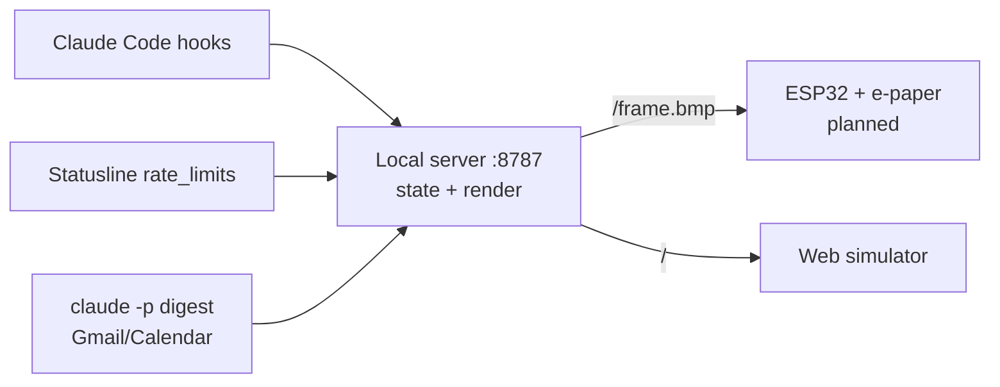

# eink-pager

An e-ink pager that saves attention: instead of watching terminals, email, and
the Claude plan usage, you glance at a small screen that only tells you
**what needs you right now**.


| Area | Shows | Source |
|---|---|---|
| Top | % used of the 5-hour and 7-day windows, and time to reset | `rate_limits` that Claude Code passes to the statusline |
| Middle | Claude Code sessions asking for permission (inverted) or finished (✓) | Claude Code hooks |
| Bottom | Next event and up to 3 emails that need action | `claude -p` + Gmail/Calendar connectors |

When nothing needs you, the screen says "Nada te necesita" ("nothing needs you").
On-device text is in Spanish.

## Architecture



The device is "dumb": it downloads a 1-bit image and draws it. All logic runs on the Mac.

## Usage

```bash
uv sync
uv run python -m pager.server          # simulator at http://127.0.0.1:8787
uv run python scripts/install.py        # preview the change to ~/.claude/settings.json
uv run python scripts/install.py --apply
uv run python -m pager.digest --dry-run # sample digest, does not call Claude
uv run pytest
```

`pager.digest` without `--dry-run` runs `claude -p` with Haiku and **spends plan quota**.
Schedule it (every 30–60 min) only after measuring the cost of one run.

## Pending

See [TODO.md](TODO.md).
