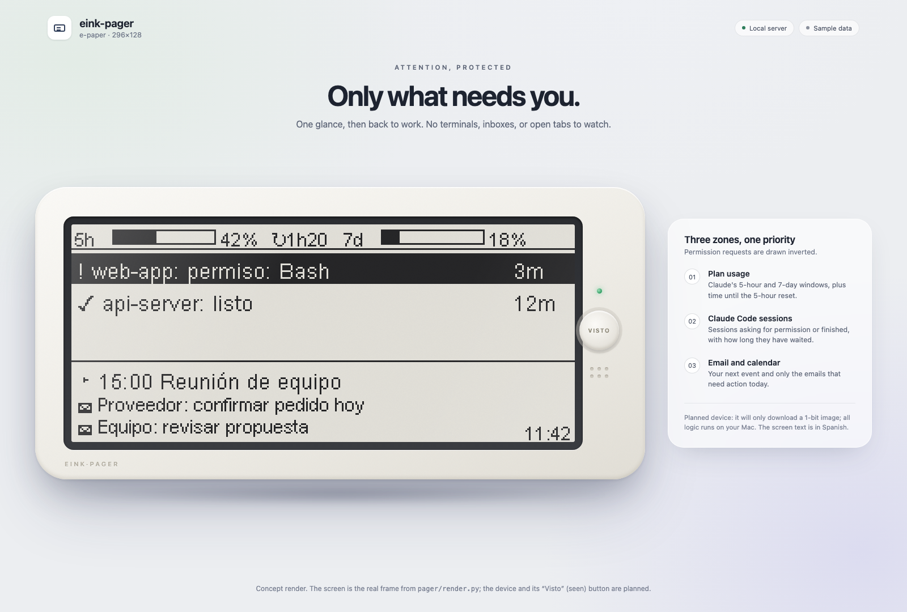
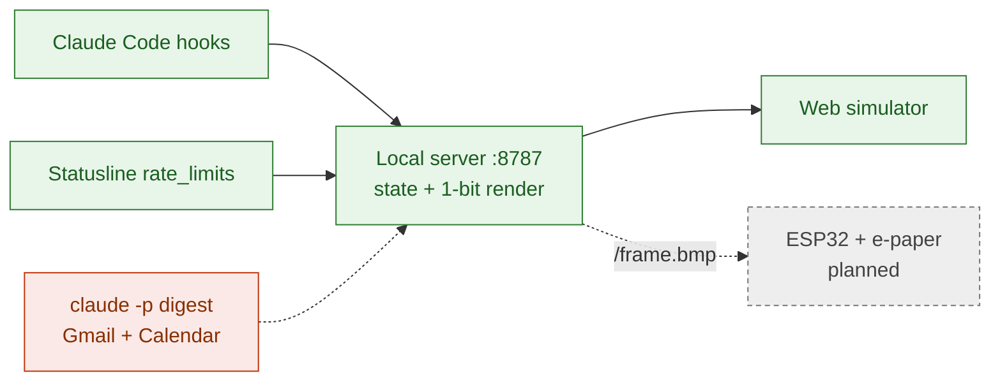
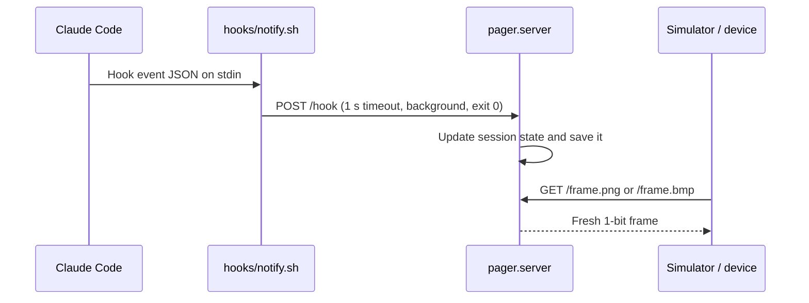
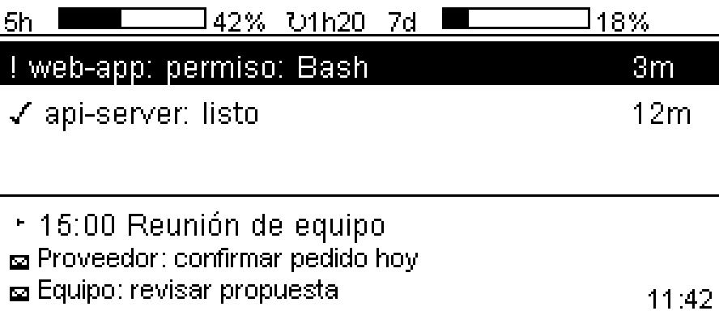
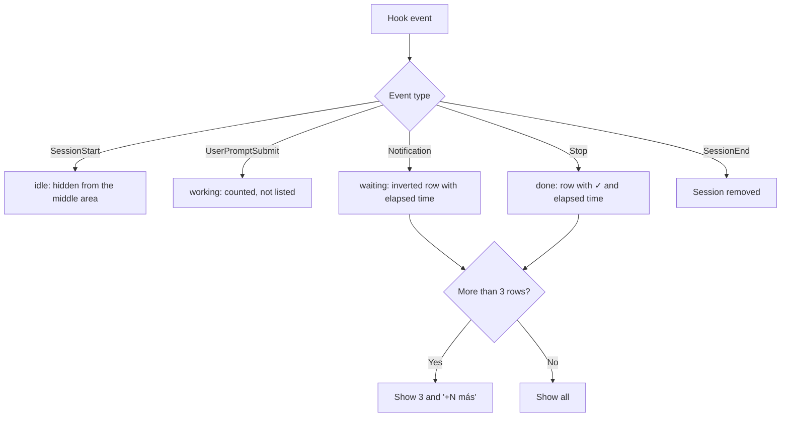
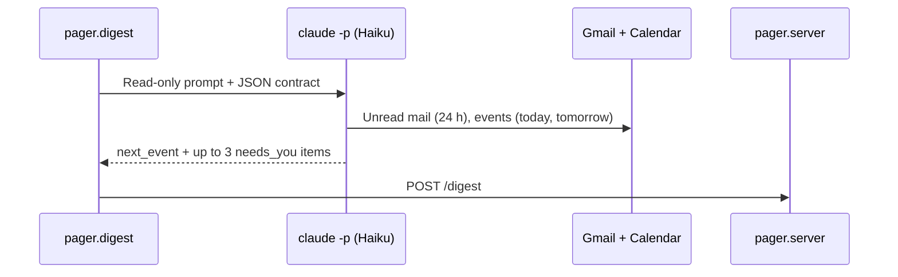

# eink-pager

An e-ink pager that shows only what needs your attention: Claude Code sessions waiting for you,
Claude plan usage, and the emails and events that require action today.
Built with Python and Pillow for a 296×128 black-and-white e-paper display.

**Available now:** a local server that receives Claude Code hooks and statusline usage, renders a
1-bit frame, and serves a [web simulator](#run-the-simulator). The email/calendar digest runs
with sample data. The ESP32 device and scheduled digests are [planned stages](TODO.md).



*Concept render with sample data. The screen is the real 1-bit frame from `pager/render.py`; the
device and its "Visto" (seen) button are planned. On-device text is in Spanish.*



Green runs locally and costs nothing. Orange spends Claude plan quota through `claude -p`; use
`--dry-run` to post sample data instead. Grey is planned. The device stays "dumb": it downloads a
1-bit image and draws it, so all decisions happen on the Mac.

## Run the simulator

Requires Python 3.12 and [uv](https://docs.astral.sh/uv/).

```bash
uv sync --locked
uv run python -m pager.server
```

Open <http://127.0.0.1:8787>. In another terminal, simulate a session asking for permission and
a sample digest:

```bash
echo '{"hook_event_name":"Notification","session_id":"demo","cwd":"/tmp/web-app","message":"Claude needs your permission to use Bash"}' | bash hooks/notify.sh
uv run python -m pager.digest --dry-run
```



- **Refresh:** the simulator reloads the frame every 10 seconds.
- **State:** stored in `~/.local/state/eink-pager/state.json`; override with `PAGER_STATE`.
- **Raw state:** <http://127.0.0.1:8787/state.json> shows what the server received.
- **Stale sessions:** sessions without events for 6 hours disappear from the screen.

The server has no authentication and listens on `127.0.0.1` by default. Use `--host 0.0.0.0`
only on a trusted network, when the device needs to reach it.

## Explore the screen states



*The 1-bit frame the server serves at `/frame.png` (296×128), scaled 3× here, with sample data. "permiso: Bash" means a session needs permission
to run Bash, "listo" means it finished, and when nothing needs you the middle area reads
"Nada te necesita".*

Sessions that need you appear first. A permission request is drawn inverted so it stands out.



| Example | Send | Screen result |
| --- | --- | --- |
| Permission request | `Notification` with `Claude needs your permission to use Bash` | Inverted `! web-app: permiso: Bash` |
| Waiting for a reply | `Notification` with `Claude is waiting for your input` | Inverted `! web-app: espera tu respuesta` |
| Finished turn | `Stop` | `✓ web-app: listo` |
| New prompt | `UserPromptSubmit` | `Nada te necesita · 1 trabajando` |
| Closed session | `SessionEnd` | Row disappears |
| Plan usage | `POST /usage` with `rate_limits` | 5-hour and 7-day bars, time to reset |

## Connect Claude Code

```bash
uv run python scripts/install.py          # preview the change
uv run python scripts/install.py --apply  # write it, after a timestamped backup
```

| Setting in `~/.claude/settings.json` | Change |
| --- | --- |
| `hooks` | Adds `hooks/notify.sh` to `SessionStart`, `UserPromptSubmit`, `Notification`, `Stop`, and `SessionEnd` |
| `statusLine.command` | Wraps your current statusline with `hooks/statusline_tee.sh`, which posts `rate_limits` at most every 30 seconds |

The installer is idempotent: running it twice adds nothing new. Hooks never block or fail a
Claude Code session, even when the server is down.

## Email and calendar digest

```bash
uv run python -m pager.digest --dry-run   # sample data, no model call
uv run python -m pager.digest             # real run: spends plan quota
```

The real run uses `claude -p` with Haiku and your account's Gmail and Calendar connectors. It
counts against your Claude plan, not an API key. Its cost per run has not been measured yet.



| Claude decides | The code decides |
| --- | --- |
| Which emails need an action or a reply today | How many lines fit and where they go |
| How to summarize each one in 50 characters | Truncation with "…" when text is still too long |
| Which event comes next | When the frame was last updated (bottom-right clock) |

The prompt forbids changes to mail or calendars: nothing is marked as read, answered, or created.

## Explore the repository

| Start here | What you will see |
| --- | --- |
| [Server](pager/server.py) | HTTP endpoints and the simulator page |
| [State](pager/state.py) | Hook events, session priorities, and persistence |
| [Render](pager/render.py) | Screen layout, fonts, and message shortening |
| [Digest](pager/digest.py) | `claude -p` prompt and JSON contract |
| [Hooks](hooks) | Hook forwarder and statusline wrapper |
| [Installer](scripts/install.py) | Changes to Claude Code settings |
| [Firmware](firmware/README.md) | Planned hardware and device loop |
| [Images](scripts/shots.py) | Regenerates `docs/preview.png` and the hero render with sample data |
| [Tests](tests/test_pager.py) | Offline checks |
| [CI](.github/workflows) | Validation, PR size limit, and Claude review |
| [TODO](TODO.md) | Pending decisions, software, and hardware work |
| [Agent rules](AGENTS.md) | Git, pull request, and documentation workflow |
